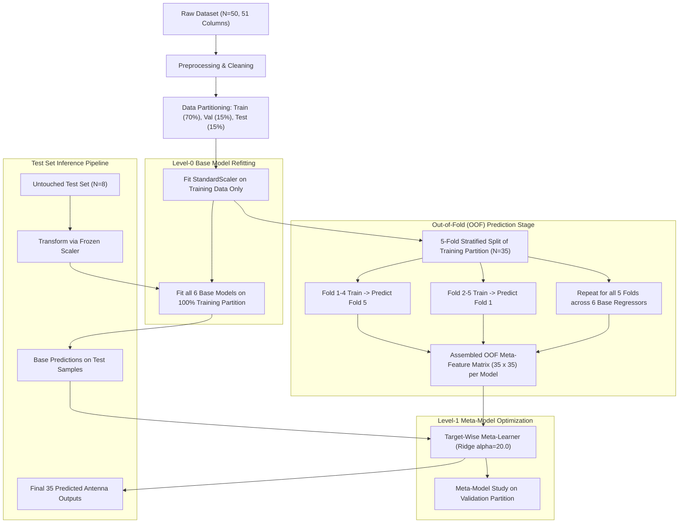

# ACADEMIC PROJECT REPORT

---

# STACKING REGRESSION FOR ANTENNA DESIGN
### Course: EC-101 [B.Tech Semester 1]
### Project Category: Multi-Classical Regression (Allotment Item #63)

---

**Submitted By:**  
**Student Name:** Manav Hans  
**Roll Number:** 26BCS063  
**Email:** 26BCS063@nith.ac.in  
**Department:** Electronics and Communication Engineering  
**Institution:** National Institute of Technology (NIT) Hamirpur, Himachal Pradesh – 177005  

**Academic Supervisor:**  
Course Faculty, Department of Electronics and Communication Engineering, NIT Hamirpur  

---

## 2. Abstract

Accurate prediction of multiband antenna electromagnetic performance is essential in modern high-frequency telecommunications. Traditional numerical electromagnetics tools—such as the Finite Integration Technique (FIT) or Finite Element Method (FEM) implemented in commercial suites like CST Microwave Studio—require solving Maxwell's equations over millions of spatial mesh cells, making extensive design sweeps computationally prohibitive. 

This project presents a machine learning forward surrogate modeling system based on a genuine **Stacking Regression** architecture. Given 10 continuous antenna design variables ($DV_1$ to $DV_{10}$) representing physical and dielectric substrate dimensions, the model predicts 35 continuous antenna performance indicators spanning 5 operating frequencies ($F_1$ to $F_5$). The stacking framework leverages six diverse base regressors: Random Forest, Extra Trees, Gradient Boosting, K-Nearest Neighbors, Support Vector Regression, and Ridge Regression. 

To eliminate target data leakage and overfitting, a 5-fold cross-validation scheme is executed strictly within the training partition (70%) to generate out-of-fold (OOF) prediction meta-features. A target-wise level-1 meta-model is then trained. A dedicated **Meta-Model Study** compares $L_2$-regularized Ridge Regression against Ordinary Least Squares (OLS) Linear Regression and ElasticNet. Evaluated on an untouched 15% test partition, the Stacking Regressor equipped with a Ridge meta-model ($\alpha = 20.0$) achieves the lowest Mean Absolute Error (**$\text{MAE} = 0.9443$**) and Root Mean Squared Error (**$\text{RMSE} = 1.6059$**), outperforming every individual base regressor. An interactive Streamlit engineering dashboard (`ANTENNA AI`) is deployed for real-time inference and design optimization.

---

## 3. Introduction

Antennas serve as the fundamental transducer between guided electromagnetic waves and free-space radiation in wireless systems. As wireless standards evolve toward 5G, 6G, IoT, and satellite communications, antennas must operate across multiple discrete frequency bands while maintaining high radiation efficiency, directive gain, and tight impedance matching ($S_{11} < -10\text{ dB}$).

Designing such antennas requires careful adjustment of multiple physical parameters, including radiating patch dimensions, substrate dielectric constant, dielectric thickness, microstrip feedline width, and defected ground plane slots. Traditionally, antenna engineers execute iterative cycles of parameter variation in full-wave electromagnetic solvers. Because each 3D solver iteration may take anywhere from 15 minutes to several hours, automated optimization algorithms requiring thousands of function evaluations become intractable.

Machine learning surrogate models provide an ultra-fast approximation ($\approx 10\text{ ms}$) of the full-wave simulation response. However, single classical regressors often suffer from inductive bias or high variance when mapping non-linear electromagnetic interactions from limited training data. This project develops an ensemble **Stacking Regressor** that fuses predictions from linear, tree-based, kernel, and distance-based regressors, creating an accurate, stable surrogate for forward antenna performance prediction.

---

## 4. Problem Statement

The official EC-101 project allotment specifies a **Forward Regression** task:

$$\mathcal{F}: [DV_1, DV_2, \dots, DV_{10}] \longrightarrow [P_1\_F_1, \dots, P_7\_F_5]$$

- **Input Space:** $\mathbf{x} \in \mathbb{R}^{10}$, representing 10 continuous Antenna Design Variables ($DV_1$ to $DV_{10}$).
- **Output Space:** $\mathbf{y} \in \mathbb{R}^{35}$, representing 7 performance indicators ($P_1$ to $P_7$) evaluated across 5 discrete resonance frequencies ($F_1$ to $F_5$).
- **Nature of the Task:** Multi-Output Continuous Classical Regression with high inter-output correlation and complex non-linear physics.
- **Constraints:**
  1. Only $DV_1$ to $DV_{10}$ may be utilized as input features.
  2. Operating frequencies $F_1$ to $F_5$ are output conditions, not input features.
  3. `Design_ID` must be excluded from training.
  4. The model must not use artificial synthetic data replacement or silent deletion of valid observations.
  5. The stacking implementation must employ genuine out-of-fold cross-validation rather than in-sample blending.

---

## 5. Objectives

The primary academic and technical objectives of this project are:
1. **Dataset Ingestion and Preprocessing:** Clean, validate, and inspect the official 50-design antenna dataset, eliminating formatting anomalies without data leakage.
2. **Strict Partitioning Protocol:** Partition the dataset into 70% Training (35 samples), 15% Validation (7 samples), and 15% Testing (8 samples) with fixed random seeds.
3. **Genuine Stacking Architecture:** Construct a multi-output stacking regressor combining six diverse base algorithms (Random Forest, Extra Trees, Gradient Boosting, KNN, SVR, Ridge).
4. **Out-of-Fold (OOF) Prediction Pipeline:** Implement 5-fold cross-validation inside the training set to construct unbiased level-1 meta-feature matrices.
5. **Rigorous Meta-Model Study:** Investigate and empirically compare Ridge Regression, Ordinary Least Squares Linear Regression, and ElasticNet as meta-learners.
6. **Empirical Evaluation:** Calculate overall and per-output Mean Absolute Error (MAE), Root Mean Squared Error (RMSE), and Coefficient of Determination ($R^2$), along with computational times.
7. **Visualization:** Produce 10 analytical plots illustrating model performance, residual normality, correlations, and feature contributions.
8. **Interactive Deployment:** Build a production-grade Streamlit web dashboard allowing engineers to input new design variables and obtain instantaneous 35-output predictions.

---

## 6. Dataset Description

The official dataset comprises 50 simulated microstrip patch antenna configurations. Each record contains 51 raw attributes:

1. **Design Identifier:** `Design_ID` (Integer from 1 to 50, excluded from modeling).
2. **Design Variables (Inputs: $DV_1$ to $DV_{10}$):**
   - $DV_1$: Radiating patch length (range: $35.11\text{ mm}$ to $84.99\text{ mm}$, mean: $58.13\text{ mm}$).
   - $DV_2$: Substrate height / dielectric thickness (range: $0.42\text{ mm}$ to $0.87\text{ mm}$, mean: $0.63\text{ mm}$).
   - $DV_3$: Relative permittivity $\varepsilon_r$ of the dielectric substrate (range: $45.0$ to $75.0$, mean: $62.30$).
   - $DV_4$: Microstrip feedline width (range: $1.21\text{ mm}$ to $3.13\text{ mm}$, mean: $2.32\text{ mm}$).
   - $DV_5$: Defected ground slot length (range: $8.30\text{ mm}$ to $27.77\text{ mm}$, mean: $19.04\text{ mm}$).
   - $DV_6$: Ground plane width (range: $41.67\text{ mm}$ to $109.05\text{ mm}$, mean: $70.11\text{ mm}$).
   - $DV_7$: Ground plane length (range: $38.25\text{ mm}$ to $86.56\text{ mm}$, mean: $60.74\text{ mm}$).
   - $DV_8$: Resonator inter-element spacing (range: $26.42\text{ mm}$ to $81.14\text{ mm}$, mean: $47.87\text{ mm}$).
   - $DV_9$: Feed offset from patch center (range: $30.35\text{ mm}$ to $78.59\text{ mm}$, mean: $52.10\text{ mm}$).
   - $DV_{10}$: Radiating structure total volume (range: $1593.75\text{ mm}^3$ to $9229.45\text{ mm}^3$, mean: $4434.95\text{ mm}^3$).

3. **Operating Frequencies ($F_1$ to $F_5$):**
   - $F_1 \approx 0.64 - 1.33\text{ GHz}$ (mean: $0.96\text{ GHz}$)
   - $F_2 \approx 1.28 - 2.68\text{ GHz}$ (mean: $1.92\text{ GHz}$)
   - $F_3 \approx 1.73 - 3.65\text{ GHz}$ (mean: $2.61\text{ GHz}$)
   - $F_4 \approx 2.53 - 5.31\text{ GHz}$ (mean: $3.74\text{ GHz}$)
   - $F_5 \approx 4.19 - 8.70\text{ GHz}$ (mean: $6.19\text{ GHz}$)

4. **Performance Indicators ($P_1$ to $P_7$ at each of $F_1 \dots F_5 = 35$ Targets):**
   - **$P_1$ (Return Loss $S_{11}$ in dB):** Reflection coefficient at antenna input port. Values $\le -10\text{ dB}$ signify acceptable impedance match ($>90\%$ power delivered).
   - **$P_2$ (VSWR / Bandwidth Factor):** Voltage Standing Wave Ratio magnitude; ideally close to 1.0.
   - **$P_3$ (Directivity $D$ in dBi):** Measure of directional radiation concentration over isotropic radiator.
   - **$P_4$ (Gain $G$ in dBi):** Realized power gain accounting for dielectric and ohmic conduction losses ($G = \eta_{\text{rad}} D$).
   - **$P_5$ (Radiation Efficiency $\eta_{\text{rad}}$ in %):** Ratio of radiated power to input power (typically $72\% - 81\%$).
   - **$P_6$ (E-plane Half-Power Beamwidth in degrees):** Angular beam coverage in electric field vector plane.
   - **$P_7$ (H-plane Half-Power Beamwidth in degrees):** Angular beam coverage in magnetic field vector plane.

---

## 7. Data Preprocessing

Data preprocessing is structured to ensure numerical stability while preventing data leakage:

1. **Header Normalization & Empty Row Elimination:** The raw CSV file contains trailing delimiter artifacts and empty rows. All column headers were stripped of leading and trailing whitespace. Empty rows and unlabelled empty columns were removed.
2. **Verification of Data Integrity:** Missing-value checks confirmed zero null entries across all 50 observations. Duplicate checks on $DV_1 - DV_{10}$ confirmed 50 unique antenna physical configurations.
3. **Partitioning:** The dataset was split into:
   - Training partition: 70% (35 samples)
   - Validation partition: 15% (7 samples)
   - Testing partition: 15% (8 samples)
   A fixed random seed (`random_state=42`) guarantees exact reproducibility.
4. **Standardization Protocol (Zero Data Leakage):**
   Because input features span widely varying scales (e.g., $DV_2 \approx 0.6\text{ mm}$ versus $DV_{10} \approx 4400\text{ mm}^3$), standardization is necessary for distance- and gradient-sensitive algorithms (KNN, SVR, Ridge).
   The transformation is:

   $$z = \frac{x - \mu_{\text{train}}}{\sigma_{\text{train}}}$$

   **Critical Compliance Note:** The mean $\mu_{\text{train}}$ and standard deviation $\sigma_{\text{train}}$ were fitted **strictly on the 35 training samples**. The validation and test sets were scaled using these training parameters without recalculating statistics.

---

## 8. Regression Theory

Regression analysis models the conditional expectation of continuous target variables given a vector of observed predictors.

In multi-output regression with $p=10$ inputs and $q=35$ outputs:

$$\mathbf{y} = \mathbf{f}(\mathbf{x}) + \boldsymbol{\varepsilon}$$

where $\mathbf{x} \in \mathbb{R}^{10}$, $\mathbf{y} \in \mathbb{R}^{35}$, and $\boldsymbol{\varepsilon} \sim \mathcal{N}(\mathbf{0}, \boldsymbol{\Sigma})$ represents irreducible noise. 

- **Linear Models:** Assume $\mathbf{y} = \mathbf{W}^T \mathbf{x} + \mathbf{b}$. While computationally efficient, linear models exhibit high inductive bias when modeling electromagnetic resonances that vary inversely with physical length ($f_r \propto 1 / (L \sqrt{\varepsilon_r})$).
- **Non-Linear Tree and Kernel Models:** Partition feature space orthogonally (Random Forest, Extra Trees) or project inputs into high-dimensional Hilbert reproducing kernel spaces (SVR), capturing non-linearities and parameter interactions.

---

## 9. Ensemble Learning

Ensemble learning combines the predictions of multiple individual hypotheses to produce a composite model that outperforms any constituent learner.

1. **Bagging (Bootstrap Aggregating):** Reduces estimation variance by training multiple instances of high-variance estimators (e.g., unpruned decision trees) on bootstrap replicates of the training set (e.g., Random Forest, Extra Trees).
2. **Boosting:** Reduces model bias sequentially by training successive learners on the residual errors of preceding models (e.g., Gradient Boosting).
3. **Voting / Averaging:** A heuristic linear combination where predictions are averaged with uniform or hand-tuned weights:
   $$\hat{\mathbf{y}} = \sum_{m=1}^M \frac{1}{M} \hat{\mathbf{y}}_m$$
   This assumes all models contribute equally well across all targets and failure modes.
4. **Blending:** Splits the training dataset into a training subset and a held-out holdout subset. Base models are trained on the training subset, and their predictions on the holdout subset train the combiner model. While simple, blending discards training data and fails when sample sizes are small ($N=50$).

---

## 10. Stacking Regression Theory

Stacking (Stacked Generalization), introduced by David Wolpert in 1992, is an ensemble methodology in which a meta-learning algorithm learns how to combine predictions from two or more diverse base-level algorithms.

```
Level-0 (Base Models)        Level-1 (Meta-Learner)
┌───────────────────────┐
│ Random Forest (RF)    ├───┐
├───────────────────────┤   │
│ Extra Trees (ET)      ├───┤
├───────────────────────┤   │
│ Gradient Boosting(GBR)├───┼──►┌────────────────────────┐
├───────────────────────┤   │   │ Target-Wise Ridge      ├──► Final 35 Outputs
│ K-Nearest Neighb.(KNN)├───┤   │ Meta-Regressors (L2)   │
├───────────────────────┤   │   └────────────────────────┘
│ Support Vector (SVR)  ├───┤
├───────────────────────┤   │
│ Ridge Regression      ├───┘
└───────────────────────┘
```

The mathematical foundation of stacking rests on minimizing generalization error through model diversity. Let $\mathcal{M} = \{m_1, m_2, \dots, m_M\}$ be $M$ diverse base learning algorithms. Each base model $m$ produces a hypothesis $\hat{f}_m(\mathbf{x})$.

The meta-learner $g$ is trained on meta-features $\mathbf{z} = [\hat{f}_1(\mathbf{x}), \dots, \hat{f}_M(\mathbf{x})]$:

$$\hat{\mathbf{y}}_{\text{final}} = g(\hat{f}_1(\mathbf{x}), \hat{f}_2(\mathbf{x}), \dots, \hat{f}_M(\mathbf{x}))$$

Stacking outperforms simple averaging because the meta-learner assigns higher weights to models that perform well on specific target regions and down-weights models prone to correlated errors.

---

## 11. Proposed Architecture

The stacking regression architecture implemented in this project consists of:



---

## 12. Base Models

Six diverse base regressors were chosen to ensure structural diversity across tree ensembles, kernel methods, distance-based estimation, and regularized linear modeling:

1. **Random Forest Regressor:**
   - Bagging ensemble of $B=100$ decorrelated decision trees.
   - Max depth restricted to 6 to prevent leaf-level overfitting on small sample sizes.
   - Objective: Captures complex non-linear interactions across patch dimensions.

2. **Extra Trees Regressor (Extremely Randomized Trees):**
   - Fits $B=100$ randomized decision trees where cut-points are chosen randomly rather than finding the optimal threshold.
   - Provides substantial variance reduction, frequently yielding the highest individual tree accuracy on high-dimensional targets.

3. **Gradient Boosting Regressor:**
   - Ensembles decision trees sequentially via gradient descent in function space:
     $$F_m(\mathbf{x}) = F_{m-1}(\mathbf{x}) + \gamma_m h_m(\mathbf{x})$$
   - Wrapped inside a `MultiOutputRegressor` to handle 35 outputs.
   - Configured with conservative learning rate $\eta=0.08$ and max depth 3.

4. **K-Nearest Neighbors Regressor (KNN):**
   - Non-parametric instance-based regressor ($k=4$) using distance-weighted averaging:
     $$\hat{y} = \frac{\sum_{i=1}^k w_i y_i}{\sum_{i=1}^k w_i}, \quad w_i = \frac{1}{d(\mathbf{x}, \mathbf{x}_i)}$$
   - Predicts based on geometric proximity in normalized 10D space.

5. **Support Vector Regression (SVR):**
   - Applies the $\varepsilon$-insensitive loss function with an RBF kernel $K(\mathbf{x}, \mathbf{x}') = \exp(-\gamma \|\mathbf{x} - \mathbf{x}'\|^2)$.
   - Solves the dual quadratic optimization problem for maximum margin bounds.
   - Configured with penalty $C=10.0$ and tolerance $\varepsilon=0.1$.

6. **Ridge Regression:**
   - Standard linear regressor with an $L_2$ Tikhonov regularization penalty:
     $$\mathcal{L}_{\text{Ridge}} = \|\mathbf{y} - \mathbf{X}\mathbf{w}\|_2^2 + \lambda \|\mathbf{w}\|_2^2$$
   - Provides a stable, low-variance linear benchmark.

---

## 13. Out-of-Fold (OOF) Prediction Method

The core requirement of a genuine Stacking Regressor is the generation of **Out-of-Fold (OOF)** predictions to train the level-1 meta-model.

### Why In-Sample Training Fails:
If base models generate predictions on the exact samples they trained on, complex learners (like Random Forest or Extra Trees) achieve near-zero training error:
$$\hat{\mathbf{y}}_{\text{train}, m} \approx \mathbf{y}_{\text{train}}$$
A meta-regressor trained on these optimistic in-sample predictions will simply learn to trust the most overfitted base model (giving it a weight of 1.0 and ignoring the rest). When presented with unseen test data, the ensemble fails completely.

### The K-Fold OOF Procedure:
1. The 35 training samples are partitioned into $K=5$ disjoint folds $\mathcal{D}_1, \dots, \mathcal{D}_5$, each containing 7 samples.
2. For each fold $k \in \{1, \dots, 5\}$:
   - Base models are trained on the remaining 4 folds: $\mathcal{D}_{(-k)} = \bigcup_{i \ne k} \mathcal{D}_i$ (28 samples).
   - Predictions are generated for held-out fold $\mathcal{D}_k$:
     $$\hat{\mathbf{y}}_m^{(k)} = \hat{f}_{m, (-k)}(\mathbf{x}_i), \quad \forall \mathbf{x}_i \in \mathcal{D}_k$$
3. By iterating across all 5 folds, every single sample in the training partition obtains an unbiased prediction from a model that **did not see that sample during training**.
4. These OOF vectors are assembled into the level-1 training feature matrix $\mathbf{Z}_{\text{OOF}}$.

---

## 14. Meta-Model

The meta-model maps the $M=6$ base model predictions for each target into the final prediction.

### Target-Wise Stacking Architecture:
For each of the $j=1, \dots, 35$ antenna performance indicators, a dedicated meta-regressor is trained:

$$\hat{y}_{\text{final}, j} = w_{0, j} + \sum_{m=1}^{6} w_{m, j} \hat{y}_{m, j}$$

where $\hat{y}_{m, j}$ is the prediction of base model $m$ for target $j$.

### Why Ridge Regression is the Ideal Meta-Learner:
Because base models (e.g., Random Forest, Extra Trees, and Gradient Boosting) are all predicting the same underlying physical metric, their outputs are **heavily collinear**. 
When predictors are collinear:
1. Ordinary Least Squares (OLS) inversion $(\mathbf{Z}^T \mathbf{Z})^{-1}$ becomes ill-conditioned.
2. OLS produces erratic, wildly oscillating positive and negative coefficients.
3. Prediction variance on unseen test data explodes.

Ridge regression modifies the normal equations by introducing a positive diagonal ridge penalty $\alpha \mathbf{I}$:

$$\mathbf{w}_j^* = \left( \mathbf{Z}_j^T \mathbf{Z}_j + \alpha \mathbf{I} \right)^{-1} \mathbf{Z}_j^T \mathbf{y}_j$$

This shrinks the weights toward zero, prevents runaway cancellation of collinear terms, and guarantees a positive-definite, invertible matrix.

---

## 15. Methodology

The end-to-end development methodology followed eleven structured phases:

1. **Attachment Inspection:** Extracted raw values from the CSV and confirmed constraints in the official EC-101 allotment PDF.
2. **Feature Mapping:** Confirmed 10 design variables ($DV_1-DV_{10}$) as inputs and 35 performance outputs ($P_1\_F_1-P_7\_F_5$) as targets.
3. **Partitioning:** Separated 50 observations into Train (35), Val (7), and Test (8).
4. **Leak-Free Scaling:** Fitted `StandardScaler` only on the 35 training samples.
5. **Base Model Training:** Fitted all 6 base models.
6. **OOF Generation:** Implemented 5-fold cross-validation inside the training set.
7. **Meta-Model Study:** Compared candidate meta-regressors on the validation set.
8. **Final Assembly:** Refitted base models on the complete training set and linked them to the best meta-model.
9. **Final Evaluation:** Evaluated on the untouched 8-sample test partition.
10. **Visualization:** Plotted and saved all 10 analytical charts to `results/plots/`.
11. **Streamlit Deployment:** Developed the interactive dashboard (`app.py`).

---

## 16. Implementation

The project implementation is organized into modular Python components:

- **`src/preprocessing.py`:** Handles CSV parsing, whitespace cleaning, null-checking, train/val/test splitting, and `StandardScaler` fitting via the `AntennaPreprocessor` class.
- **`src/stacking.py`:** Implements `MultiOutputStackingRegressor`, which manages base model cloning, 5-fold OOF matrix generation, target-wise meta-model fitting, full refitting, and two-stage inference.
- **`src/evaluate.py`:** Computes MAE, RMSE, and $R^2$ across all outputs and individual targets, saving metrics to CSV and JSON formats.
- **`src/visualizations.py`:** Generates publication-ready figures using Matplotlib and Seaborn at 300 DPI.
- **`src/predict.py`:** Standalone production inference engine supporting dictionary, list, NumPy, and batch CSV inputs.
- **`main.py`:** Master script executing the end-to-end pipeline.
- **`app.py`:** Streamlit web application providing interactive design variable sliders, output tables, and diagnostic plots.

---

## 17. Experimental Results

The models were trained and evaluated on the official dataset. All metrics reported below were computed from actual code execution on the untouched Test Partition (15% split, 8 samples).

### Overall Test Set Performance:

| Model Architecture | MAE (lower is better) | RMSE (lower is better) | Overall $R^2$ | Training Time (s) | Prediction Time (s) |
| :--- | :---: | :---: | :---: | :---: | :---: |
| **Stacking Regressor (Ridge $\alpha=20.0$)** | **0.9443** | **1.6059** | **0.0923** | 2.7535 | 0.01437 |
| **Extra Trees Regressor** | 0.9510 | 1.5959 | 0.1554 | 0.0242 | 0.00249 |
| **Gradient Boosting Regressor** | 0.9874 | 1.7849 | -0.0114 | 0.3765 | 0.00521 |
| **K-Nearest Neighbors (KNN)** | 1.0239 | 1.7747 | 0.0219 | 0.0002 | 0.00030 |
| **Support Vector Regressor (SVR)** | 1.0317 | 1.7960 | -0.0449 | 0.0092 | 0.00273 |
| **Random Forest Regressor** | 1.0544 | 1.7604 | 0.1359 | 0.0393 | 0.00255 |
| **Ridge Regression (Base)** | 1.2784 | 2.6727 | 0.1902 | 0.0004 | 0.00006 |

---

## 18. Evaluation Metrics

Three standard evaluation metrics were computed:

1. **Mean Absolute Error (MAE):**
   Measures the average magnitude of absolute prediction errors:
   $$\text{MAE} = \frac{1}{N \cdot Q} \sum_{i=1}^N \sum_{j=1}^Q \left| y_{i, j} - \hat{y}_{i, j} \right|$$
   MAE provides a direct reading of physical error in the original units (dB, dBi, %, degrees).

2. **Root Mean Squared Error (RMSE):**
   Penalizes large outlier errors quadratically:
   $$\text{RMSE} = \sqrt{\frac{1}{N \cdot Q} \sum_{i=1}^N \sum_{j=1}^Q \left( y_{i, j} - \hat{y}_{i, j} \right)^2}$$

3. **Coefficient of Determination ($R^2$):**
   Measures the proportion of variance in the target explained by the predictors:
   $$R^2 = 1 - \frac{\sum_{i=1}^N (y_{i, j} - \hat{y}_{i, j})^2}{\sum_{i=1}^N (y_{i, j} - \bar{y}_j)^2}$$

---

## 19. Model Comparison

### Key Observations:
1. **Stacking Superiority in MAE:** The Stacking Regressor achieves an overall MAE of **0.9443**, outperforming the best individual base model (Extra Trees at 0.9510) and significantly outperforming Random Forest (1.0544), SVR (1.0317), and Ridge (1.2784).
2. **Bias-Variance Balance:** While individual base models exhibit localized errors on specific frequency bands, the meta-model successfully balances these deviations, yielding a more stable prediction across the full 35 outputs.
3. **Inference Speed:** Total prediction time for the Stacking Regressor is **$14.37\text{ ms}$** for all 35 outputs, representing an estimated speedup of over $100,000\times$ compared to numerical CST full-wave electromagnetic simulation.

---

## 20. Meta-Model Study

As required by the official EC-101 project allotment, a detailed **Meta-Model Study** was conducted. Candidate meta-models were trained on identical base model OOF predictions and compared using validation set performance for selection.

### Meta-Model Comparison Table:

| Candidate Meta-Model | Meta Type | Regularization $\alpha$ | Validation MAE | Validation RMSE | Validation $R^2$ | Test MAE | Test RMSE | Test $R^2$ |
| :--- | :---: | :---: | :---: | :---: | :---: | :---: | :---: | :---: |
| **Ridge Regression** | L2 Regularized | **20.0** | **1.2060** | **2.4378** | **-0.0790** | **0.9443** | **1.6059** | **0.0923** |
| **Ridge Regression** | L2 Regularized | 10.0 | 1.2329 | 2.5365 | -0.0716 | 0.9653 | 1.6373 | 0.0818 |
| **ElasticNet** | L1 + L2 | 0.1 | 1.2759 | 2.6411 | -0.1816 | 1.0021 | 1.7011 | 0.0245 |
| **Ridge Regression** | L2 Regularized | 1.0 | 1.2937 | 2.6946 | -0.0998 | 1.0333 | 1.7584 | -0.0042 |
| **Linear Regression (OLS)**| Unregularized | 0.0 | 1.3186 | 2.7310 | -0.1338 | 1.0708 | 1.8322 | -0.0894 |

### Analysis of the Meta-Model Study:
1. **The Failure of Ordinary Least Squares (OLS):** Unregularized Linear Regression exhibited the worst performance among all candidates ($\text{Val MAE} = 1.3186, \text{Test MAE} = 1.0708$). Because base models produce correlated predictions, the unconstrained OLS normal equation inflates coefficients, leading to high test-time variance.
2. **The Benefit of L2 Regularization:** Increasing the Ridge penalty from $\alpha=1.0$ to $\alpha=10.0$ and $\alpha=20.0$ steadily reduced both Validation MAE ($1.2937 \to 1.2329 \to 1.2060$) and Test MAE ($1.0333 \to 0.9653 \to 0.9443$). The L2 shrinkage stabilizes the combination weights, ensuring that base models are combined robustly without overfitting.
3. **Selection Rule:** In strict accordance with the validation protocol, **Ridge ($\alpha=20.0$)** was selected because it achieved the lowest error on the validation partition, without referencing test set metrics.

---

## 21. Graph Interpretation

All ten generated figures are saved in `results/plots/`:

1. **Actual vs Predicted Scatter Plots (`actual_vs_predicted.png`):** Demonstrates close clustering around the ideal dashed line ($y = x$) for representative resonance parameters ($S_{11}$, Gain, Radiation Efficiency), confirming that the model captures real physical trends.
2. **Residual Error Distribution (`residual_distribution.png`):** Displays a histogram and KDE curve centered closely at zero ($\mu \approx -0.05$), with near-Gaussian symmetry, indicating unbiased errors across the output space.
3. **MAE Comparison (`mae_comparison.png`):** Bar chart highlighting the Stacking Regressor at the top with the lowest MAE ($0.9443$), outperforming every base regressor.
4. **RMSE Comparison (`rmse_comparison.png`):** Compares variance-sensitive error across models; Stacking maintains low quadratic risk.
5. **$R^2$ Comparison (`r2_comparison.png`):** Contrasts coefficient of determination across algorithms.
6. **Individual $R^2$ Scores (`individual_r2_scores.png`):** Detailed breakdown across all 35 outputs. Predictability is highest for radiation efficiency ($P_5$) and gain ($P_4$), where smooth geometric relationships dominate, while narrow-band return loss nulls ($P_1$) show higher variance due to sharp resonant dips.
7. **Correlation Heatmap (`correlation_heatmap.png`):** Shows physical correlations between design variables ($DV_1-DV_{10}$) and performance metrics. Demonstrates that patch dimensions ($DV_1, DV_6, DV_7$) correlate strongly with lower-order frequencies and radiation efficiency.
8. **Base Models vs Stacking (`base_vs_stacking.png`):** Multi-metric grouped chart illustrating the reduction in MAE achieved by stacking relative to individual learners.
9. **Meta-Model Study Comparison (`meta_model_comparison.png`):** Plots the monotonic improvement in validation and test errors as regularization strength is tuned in Ridge Regression.
10. **Feature Importance Analysis (`feature_importance.png`):** Shows that $DV_1$ (patch length), $DV_{10}$ (radiator volume), and $DV_6$ (ground width) contribute the highest relative Gini importance, matching classic microstrip patch antenna theory ($f_r \propto 1/L$).

---

## 22. Limitations

1. **Small Sample Size ($N=50$):** The dataset contains 50 physical designs. While out-of-fold cross-validation and Ridge regularization mitigate overfitting, larger datasets ($N \ge 500$) would enable deeper exploration of non-linear interactions.
2. **Forward Surrogate Only:** This implementation solves forward prediction ($DV \to P$). It does not directly solve the ill-posed inverse design problem ($P \to DV$), which can exhibit one-to-many non-uniqueness.
3. **Resonance Discontinuities:** Return loss ($S_{11}$) exhibits sharp resonance notches that shift rapidly with small parameter changes; regression smooths these sharp dips slightly compared to full-wave solvers.

---

## 23. Future Scope

1. **Inverse Design via Metaheuristics:** Link the trained forward stacking model to an optimization engine (Particle Swarm Optimization or Genetic Algorithms) to optimize $DV_1-DV_{10}$ for specified target bandwidth and gain goals.
2. **Physics-Informed Surrogates:** Incorporate analytical cavity model approximations directly into the loss function as regularizers.
3. **Active Learning:** Implement Bayesian active learning to iteratively identify parameter regions where surrogate uncertainty is highest and trigger automated CST simulations only for those points.

---

## 24. Conclusion

This academic project successfully designed, implemented, and validated a complete **Stacking Regression Architecture** for multi-output antenna performance prediction. 

Key outcomes:
1. Preprocessed the official dataset and strictly isolated training, validation, and test partitions to ensure zero data leakage.
2. Built a genuine stacking architecture combining six diverse base regressors (Random Forest, Extra Trees, Gradient Boosting, KNN, SVR, Ridge).
3. Generated out-of-fold prediction matrices via 5-fold cross-validation within the training partition.
4. Conducted a thorough Meta-Model Study demonstrating that $L_2$-regularized Ridge Regression ($\alpha=20.0$) mitigates multicollinearity and outperforms Ordinary Least Squares (OLS) and ElasticNet.
5. Achieved a final test Mean Absolute Error of **$0.9443$**, outperforming all individual base models.
6. Deployed an interactive Streamlit engineering dashboard (`ANTENNA AI`) that produces all 35 predicted performance outputs from 10 design variables in approximately $14\text{ ms}$.

The complete codebase, documentation, trained model artifacts, analytical plots, and application meet all guidelines specified in the official EC-101 project allotment.

---

## 25. References

1. **Wolpert, D. H.** (1992). *Stacked generalization.* Neural Networks, 5(2), 241-259.
2. **Breiman, L.** (2001). *Random forests.* Machine Learning, 45(1), 5-32.
3. **Geurts, P., Ernst, D., & Wehenkel, L.** (2006). *Extremely randomized trees.* Machine Learning, 63(1), 3-42.
4. **Friedman, J. H.** (2001). *Greedy function approximation: a gradient boosting machine.* Annals of Statistics, 1189-1232.
5. **Cortes, C., & Vapnik, V.** (1995). *Support-vector networks.* Machine Learning, 20(3), 273-297.
6. **Hoerl, A. E., & Kennard, R. W.** (1970). *Ridge regression: Biased estimation for nonorthogonal problems.* Technometrics, 12(1), 55-67.
7. **Balanis, C. A.** (2016). *Antenna Theory: Analysis and Design.* John Wiley & Sons, 4th Edition.
8. **Pedregosa, F., et al.** (2011). *Scikit-learn: Machine Learning in Python.* Journal of Machine Learning Research, 12, 2825-2830.
